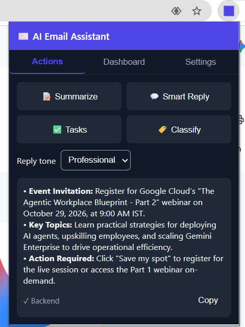
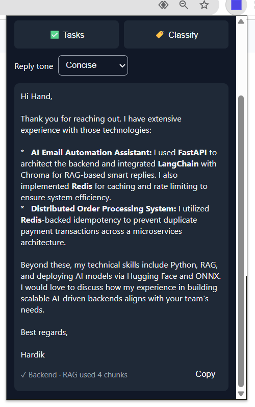
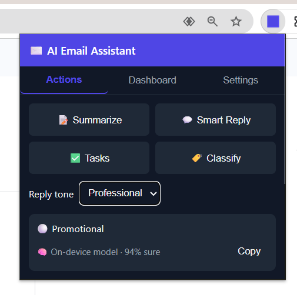
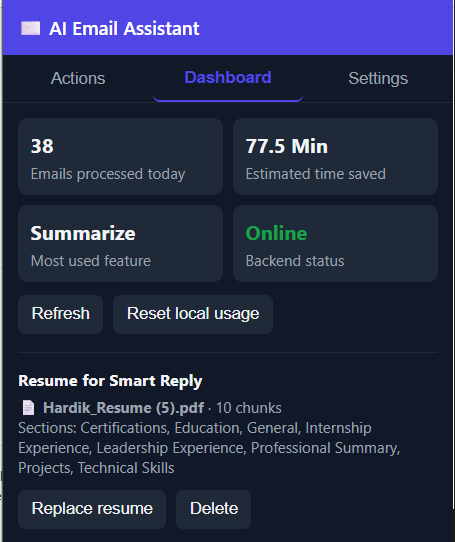
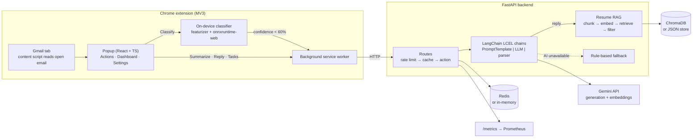

# AI Email Automation Assistant


A Gmail Chrome extension that **summarizes emails, writes resume-aware replies, extracts tasks and classifies emails**, backed by a FastAPI + LangChain service and an ML classifier that runs **entirely in the browser**.

## Highlights

- **Resume-aware Smart Reply (RAG).** Upload your resume once; replies to recruiters cite your real projects and skills. Retrieval uses section-aware chunks, Gemini embeddings and ChromaDB, with a relevance filter so unrelated emails never get resume details stuffed in.
- **On-device classifier.** A model trained in Python, exported to ONNX and run with `onnxruntime-web`. Classification is instant, works offline, and the email never leaves the browser. Low-confidence predictions are handed to the backend AI.
- **Verified ML pipeline.** CI checks that the browser featurizer and model produce the same output as Python on 630 emails (0 mismatches).
- **Production-minded backend.** Response caching, per-client rate limiting, Prometheus metrics, JWT auth, graceful fallbacks when the AI or Redis is unavailable, and 22 automated tests.

## Screenshots

| Summarize | Resume-aware reply | On-device classify | Dashboard |
|---|---|---|---|
|  |  |  |  |

## Architecture



## Features

| Action | How it works |
|---|---|
| **Summarize** | 3 bullets with bold categories (**Action Required**, **Key Info**, **FYI**) |
| **Smart Reply** | Tone picker (professional, friendly, concise). Uses resume context when relevant and shows `RAG used N chunks` or `RAG no resume match` |
| **Tasks** | Extracts tasks and deadlines as a checklist |
| **Classify** | Urgent · Opportunity · Meeting · Promotional · Normal, on-device first |
| **Dashboard** | Emails processed, time saved, most-used feature, backend status, resume upload and history |

Every action degrades gracefully: if the backend is down, the extension uses local rules; if Gemini fails, the backend does the same. The UI always says which path answered.

## Tech stack

| Layer | Tools |
|---|---|
| Extension | Chrome Manifest V3, React, TypeScript, Vite, onnxruntime-web (WebAssembly) |
| Backend | FastAPI, Pydantic, LangChain Core (LCEL), Google Gemini, PyJWT |
| RAG | pypdf, python-docx, Gemini `gemini-embedding-001`, ChromaDB (JSON fallback) |
| ML | scikit-learn, skl2onnx, ONNX Runtime |
| Infra | Redis, Prometheus, Docker Compose, GitHub Actions |

## Resume RAG

1. Extract text from the PDF or DOCX, keeping line breaks.
2. Detect sections (Projects, Skills, Education…) and chunk each one separately (700 characters, 120 overlap, word boundaries), so a chunk never mixes two sections.
3. Embed each chunk with its section name prefixed, and store it in ChromaDB.
4. On Smart Reply, embed the email as a query, take the top 4 chunks and **drop any below 0.55 similarity**.
5. Generate the reply with only the surviving chunks, instructed never to invent facts.

## On-device classifier

- **Features:** hashing trick over words, word pairs and 4-character pieces (4,096 dims), log-scaled and L2-normalised. The same code exists in Python (`ml/featurize.py`) and TypeScript (`extension/src/shared/featurize.ts`).
- **Model:** multinomial logistic regression, exported with `skl2onnx` (~100 KB).
- **Data:** the public SMS Spam Collection (real spam and normal messages) plus generated emails for Urgent, Opportunity and Meeting, assembled from phrase banks. Test emails use phrases **held out** from training.

| Evaluation | Accuracy | Macro F1 |
|---|---|---|
| Held-out test set (610 emails, unseen phrasing) | 79.8% | 0.73 |
| Hand-written realistic emails (20) | 80% | 0.77 |

The first version, trained on fixed templates, scored only 45% on realistic emails because it memorised the templates. Phrase-bank data and character n-grams raised it to 80%. Urgent recall on unfamiliar wording is still the weakest area, which is why low-confidence predictions go to the backend AI.

## Production features

- **Caching:** SHA-256 key of the action and email. Only real AI answers are cached, never fallbacks. Reply keys include the resume upload time, so a new resume invalidates old replies.
- **Rate limiting:** 30 AI requests per client per minute, then `429` with `Retry-After`.
- **Metrics** at `/metrics`: requests and latency per route, AI vs fallback results, cache hits and misses, rate-limit rejections.
- **Health** at `/health`: whether AI is enabled and which cache and vector store are active.
- **Secrets:** API key sent in a request header (never in URLs or logs); `.env` is git-ignored.

## Getting started

**Backend**

```bash
cd backend
python -m venv .venv
.venv\Scripts\activate            # macOS/Linux: source .venv/bin/activate
pip install -r requirements.txt
copy ..\.env.example .env         # then set GEMINI_API_KEY (free at aistudio.google.com/apikey)
uvicorn app.main:app --port 8001 --reload
```

API docs: http://127.0.0.1:8001/docs

**Extension**

```bash
npm --prefix extension install
npm run build:extension
```

Open `chrome://extensions`, turn on **Developer mode**, click **Load unpacked**, and select `extension/dist`. Refresh Gmail, open an email, and click the extension icon.

**Full stack with Docker** (API with ChromaDB, Redis, Prometheus at :9090)

```bash
docker compose -f infra/docker-compose.yml up --build
```

**Retrain the classifier**

```bash
pip install -r ml/requirements.txt
python ml/data/build_dataset.py
python ml/training/train_classifier.py
```

## Tests

```bash
cd backend && python -m pytest tests -q          # 22 tests
node --experimental-strip-types ml/evaluation/check_parity.mjs   # after ml/evaluation/export_reference.py
```

CI runs three jobs on every push: backend tests, extension build, and Python-vs-browser ML parity.

## Project structure

```
extension/   MV3 extension: popup, Gmail content script, background worker, ONNX classifier
backend/     FastAPI app: routes, LangChain chains, RAG, cache, rate limiter, metrics, tests
ml/          Dataset builder, featurizer, training, ONNX export, parity check
infra/       Docker Compose and Prometheus config
.github/     CI workflow
```

## Limitations and next steps

- Demo JWT auth; real Google OAuth is the next step before any public release.
- Gmail reading is DOM-based, so very long emails need "View entire message" expanded first.
- The classifier is trained mostly on generated data; real labelled emails would improve it most.
- Usage stats are kept in memory on the backend.
